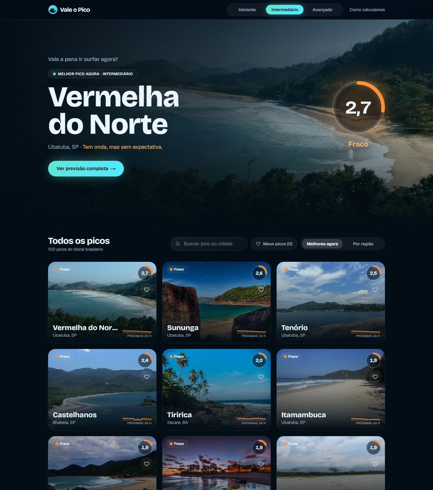
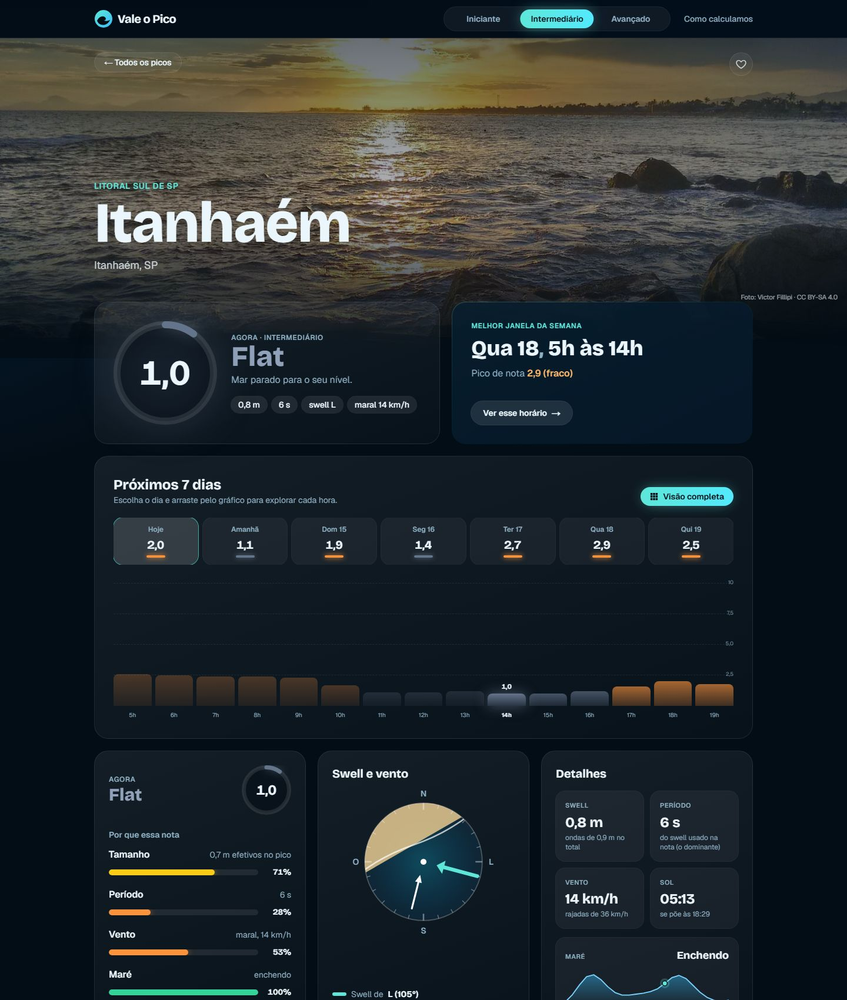

# Vale o Pico

[](https://github.com/rafinhatsantos/vale-o-pico/actions/workflows/ci.yml)
[](LICENSE)


**Previsão de surfe do Sul ao Nordeste do Brasil.** Em vez de tabelas de números, cada pico recebe uma nota de 0 a 10 por horário, ajustada ao nível do surfista. O site responde uma pergunta só: *vale a pena ir?*

**[Ver no ar →](https://surf-view.vercel.app)** · [Sobre o projeto](https://surf-view.vercel.app/sobre)

<p align="center">
  
  
</p>

## O que tem

- **100 picos** de SC ao Ceará, com foto e ficha (swell que entra bem, vento terral, maré, fundo).
- **Nota de 0 a 10 por pico e por horário**, calculada para o nível escolhido: iniciante, intermediário ou avançado.
- **Melhor janela da semana** e previsão de 7 dias, hora a hora.
- **Visão completa**: mapa de calor da semana, ondas, período, vento e maré, com reprodução animada.
- **Mapa interativo** com a nota de cada pico agora.
- **Favoritos** e filtro "Meus picos", salvos no navegador, sem login.
- **Explica a nota**: cada fator (tamanho, período, vento, maré) aparece com o peso que teve.

## Como a nota é calculada

```
nota = 10 × tamanho (ajustado ao nível) × período × vento × maré
```

Os fatores se multiplicam: um fator ruim derruba tudo. O tamanho é a altura do swell × exposição do pico × encaixe da direção na janela da ficha, comparado com a faixa ideal do nível. Detalhes e limites em [`/como-calculamos`](https://surf-view.vercel.app/como-calculamos).

## Stack

- **Next.js 16** (App Router, Cache Components) e **React 19**
- **TypeScript**, **Tailwind CSS 4**
- **MapLibre GL** para o mapa
- **Open-Meteo** (Marine e Weather) como fonte dos dados
- **Vercel** para hospedagem, **GitHub Actions** para CI
- Testes com o test runner do Node

## Arquitetura em uma frase

Uma camada de dados (`src/lib/forecast`) é o único ponto que conhece a fonte; ela busca os 100 picos em duas chamadas, guarda por cerca de 1 hora e calcula a nota com uma função pura (`src/lib/score.ts`). Páginas e componentes só consomem o resultado. O estado do usuário (nível e favoritos) vive no navegador.

Mais em [`docs/ARQUITETURA.md`](docs/ARQUITETURA.md).

## Qualidade

Lighthouse no celular, medido no build de produção local: desempenho 87 a 94, acessibilidade 97 a 100, boas práticas 100 e SEO 100. O MapLibre, que é a parte mais pesada, só carrega quando o mapa chega perto da tela. O CI roda tipos, lint, testes, build e os testes de ponta a ponta (favoritos, Visão completa sem rolagem horizontal no celular, 404, sitemap e manifesto) a cada push. O site também pode ser instalado como app na tela inicial.

## Decisões e limites (de propósito, à vista)

- **A nota é uma estimativa.** A fórmula é um primeiro chute, ainda a calibrar contra o mar real.
- **As fichas dos picos são rascunho.** Cada página avisa e tem um link para quem surfa no lugar dizer o que está errado.
- **Sem login ainda.** Favoritos e nível ficam no `localStorage`; a consequência é que não acompanham o usuário entre aparelhos.
- **A fonte gratuita não permite uso comercial.** Antes de monetizar, é preciso trocar de provider (o contrato em `src/lib/forecast/provider.ts` existe para isso).

## Como rodar

```bash
npm install
npm run dev
```

Abra http://localhost:3000.

```bash
npm test          # testes da nota, da maré, do swell e dos favoritos
npm run typecheck
npm run lint
npm run build
```

Testes de ponta a ponta (Playwright, no desktop e num celular), com o site já compilado:

```bash
npm run build
npx playwright install chromium   # uma vez
npm run test:e2e
```

Sem baixar o Chromium, dá para usar um navegador que já exista: `PW_CHANNEL=msedge npm run test:e2e`.

## Estrutura

| Caminho | O que é |
| --- | --- |
| `src/lib/spots.ts` | Fichas dos picos |
| `src/lib/score.ts` | Função da nota |
| `src/lib/forecast/` | Camada de dados, cache e provider da Open-Meteo |
| `src/app/` | Páginas, metadados, sitemap e imagens de compartilhamento |
| `src/components/` | Interface (mapa, gráficos, cartões) |
| `src/hooks/` | Nível e favoritos no navegador |
| `e2e/` | Testes de ponta a ponta (Playwright) |
| `docs/` | Arquitetura e imagens deste README |

## Próximos passos

- Calibrar a nota com surfistas de cada região e tirar as fichas do rascunho.
- Segunda fonte de ondas para cruzar com a primeira.
- Contas, alertas ("avise quando passar de 7") e sincronização entre aparelhos, em um repositório privado com back-end próprio.

## Dados, fotos e licença

A previsão vem da [Open-Meteo](https://open-meteo.com/). As fotos dos picos têm licenças próprias (a maioria do Wikimedia Commons), listadas em [Créditos das fotos](https://surf-view.vercel.app/creditos). O código está sob a licença [MIT](LICENSE); as fotos não.
