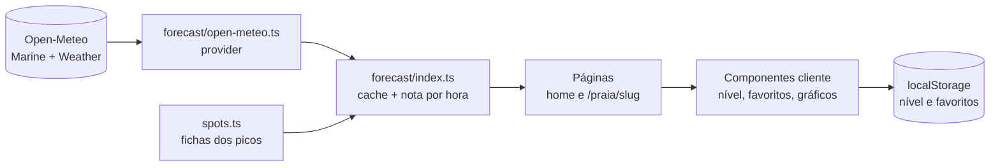

# Arquitetura

Este documento explica como o Vale o Pico é organizado e por que algumas decisões foram tomadas. O código é pequeno de propósito: a ideia é que dê para ler de ponta a ponta.

## Visão geral

O servidor busca a previsão, calcula a nota e entrega páginas já prontas. O navegador só cuida do que depende de quem está usando: o nível escolhido, os favoritos e a interação com gráficos e mapa.

## Camadas

| Camada | Onde | Responsabilidade |
| --- | --- | --- |
| Fichas dos picos | `src/lib/spots.ts` | Coordenadas, orientação da praia, janela de swell, exposição, terral, maré e nível. Um arquivo, sem banco. |
| Fonte de dados | `src/lib/forecast/open-meteo.ts` | Único ponto que conhece a Open-Meteo. Implementa o contrato `ForecastProvider`. |
| Contrato | `src/lib/forecast/provider.ts` | Formato bruto de um horário. Trocar de fonte é escrever outro provider. |
| Cache e montagem | `src/lib/forecast/index.ts` | Busca todos os picos de uma vez, guarda por cerca de 1 hora e calcula a nota de cada horário. |
| Nota | `src/lib/score.ts` | Função pura da nota de 0 a 10. Testada. |
| Maré | `src/lib/forecast/tide.ts` | Classifica o nível do mar em seca, cheia, enchente e vazante. Testada. |
| Interface | `src/app`, `src/components` | Páginas, mapa, gráficos e seletor de nível. |
| Estado do navegador | `src/hooks` | Nível e favoritos, via `useSyncExternalStore`. |

## Decisões

### A fonte de dados fica atrás de um contrato
Páginas e componentes só chamam `getForecast` e `getForecastSummary`. Nenhum componente sabe que a fonte é a Open-Meteo. Isso deixa trocar para outro serviço, ou para um back-end próprio, mexendo em um arquivo.

### Uma chamada para todos os picos
A Open-Meteo aceita várias coordenadas por requisição. O site faz duas chamadas (ondas e vento) para os 100 picos, não 200. O resultado fica em cache no servidor por cerca de 1 hora (`"use cache"` com `cacheLife("hours")`), então nenhum visitante dispara chamada direta à API. Se a fonte falha, a falha é guardada por poucos minutos para tentar de novo logo, sem martelar a API.

### Nota é uma função única e multiplicativa
`nota = 10 × tamanho × período × vento × maré`. Os fatores se multiplicam, então um fator ruim derruba a nota inteira: swell perfeito com maral forte não vale nada. Uma função só, sem ramificações por pico, facilita testar e explicar (a página `/como-calculamos` descreve cada fator). Os números são um primeiro chute a calibrar contra o mar real.

### O tamanho depende do nível
O mesmo mar dá notas diferentes para iniciante, intermediário e avançado: cada nível tem uma faixa de tamanho efetivo ideal. O tamanho efetivo é a altura do swell × exposição do pico × encaixe da direção na janela de swell da ficha.

### Escolha do swell dominante
O modelo de ondas separa o mar em partições. A primária é só a de maior altura, e pode ser um mar curto enquanto o swell longo, o que importa para surfar, vem como secundária. O site escolhe a partição com maior altura × período e mostra a outra na tela (`src/lib/forecast/swell.ts`).

### Páginas pré-renderizadas com Cache Components
Home e páginas de pico são geradas no servidor a partir do cache. O "agora" de verdade só existe no navegador, então um hook (`useNow`) escolhe o horário em curso no cliente. O resto do HTML não depende de quem visita.

### Estado do usuário sem login
Nível e favoritos ficam no `localStorage`, com `useSyncExternalStore` para sincronizar abas. Os favoritos têm formato versionado, descartam valores inválidos e caem para memória se o navegador bloquear o armazenamento. Limitações conhecidas: ficam só naquele aparelho e navegador, e o Safari pode apagar dados de sites sem visita por cerca de 7 dias.

### Fotos hospedadas no projeto
As fotos dos picos vêm do Wikimedia Commons com licença livre e ficam em `public/picos`, para o site não depender de outro servidor. Os créditos ficam em `src/lib/photos.ts` e aparecem na página do pico e em `/creditos`. Picos sem foto usam uma arte gerada.

## Limitações assumidas
- As fichas dos picos são rascunho até alguém que surfa conferir.
- A fórmula da nota é um chute inicial.
- A Open-Meteo gratuita não permite uso comercial.
- A maré vem do nível do mar modelado, não de uma tábua oficial.

## Próxima fase
Conta de usuário, favoritos e alertas sincronizados e um back-end próprio. Está planejado para um repositório privado separado, partindo deste código.
